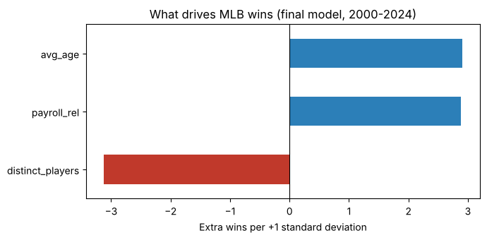

# Does Money Buy Wins in MLB?

A regression study of 720 MLB team-seasons (2000–2024, 2020 excluded) asking whether higher payroll leads to more wins, and how much one extra win costs.

**Short answer:** yes, but the class model overstated what it could tell us. Its two strongest predictors were partly *caused by* winning. After fixing that and adjusting payroll for inflation, every +10% of payroll above the league average buys about **0.72 wins (95% CI 0.48–0.96)**, roughly **$21M per win in 2024 dollars**. Roster stability and player age matter about as much as money.



## The story in four steps

**1. The class model looked strong (R² = 0.48).**
Wins were regressed on payroll, home attendance, roster churn (distinct players used), average age, and a manager-quality score. Payroll was significant, at about $21M per extra win in nominal dollars.

**2. But its two strongest variables are partly outcomes, not causes.**
- *Manager quality* came from Manager of the Year votes, which are cast after the season and mostly reward teams that won.
- *Home attendance* rises when a team is winning.

Both flow partly from wins to the variable rather than the other way around (reverse causality).

**3. Payroll was also measured in nominal dollars.**
League-average payroll rose from $55.7M (2000) to $153.7M (2024). Re-expressing payroll relative to each season's league average makes it a *stronger* predictor on its own (R² 0.093 → 0.150). In the full model, though, its effect is absorbed by attendance, which is 0.75 correlated with relative payroll, since big-market teams both spend and draw crowds.

**4. A defensible model keeps only variables not driven by the result.**

| Model | n | R² | Payroll p-value | $ per extra win |
|---|---|---|---|---|
| Payroll only, nominal | 721 | 0.093 | <0.001 | $14.0M (nominal) |
| Class model, 5 variables, nominal | 721 | 0.481 | <0.001 | $21.3M (nominal) |
| Class model, inflation-adjusted | 720 | 0.475 | 0.984 | n/a (not significant) |
| **Final: payroll + roster churn + age** | **720** | **0.271** | **<0.001** | **$21.3M (2024 $)** |

Effect of a one-standard-deviation increase in the final model: roster churn −3.1 wins, payroll +2.9, average age +2.9.

## Data fixes
- The dataset covers 2000–2024, not 2000–2025 as first reported.
- The 2022 Washington Nationals appeared twice. The 71-win row was removed (the team's actual record was 55–107), leaving 720 team-seasons.

## Limitations
- This is observational data, so the results show association, not a clean causal effect.
- Reverse causality can also run through payroll: winning raises revenue, which funds payroll.
- Roster churn partly reflects injuries and mid-season sell-offs, which losing can cause.
- The final model explains 27% of the variation in wins. Most of what decides a season isn't captured here.
- There are no team fixed effects, so stable traits like market size and ownership are only partly controlled.

## Files
- `mlb_regression_v2.ipynb`: full analysis, with outputs
- `data/df_final_merged.csv`: team-season dataset (Lahman Baseball Database plus public team payroll data)
- `requirements.txt`: Python packages

Run it locally:
```
pip install -r requirements.txt
jupyter notebook mlb_regression_v2.ipynb
```

## Credits
This began as a team project for DSO 510 at the USC Marshall School of Business (Group D4). The inflation adjustment, reverse-causality analysis, data fixes, and final model in this repository are a follow-up re-analysis.
